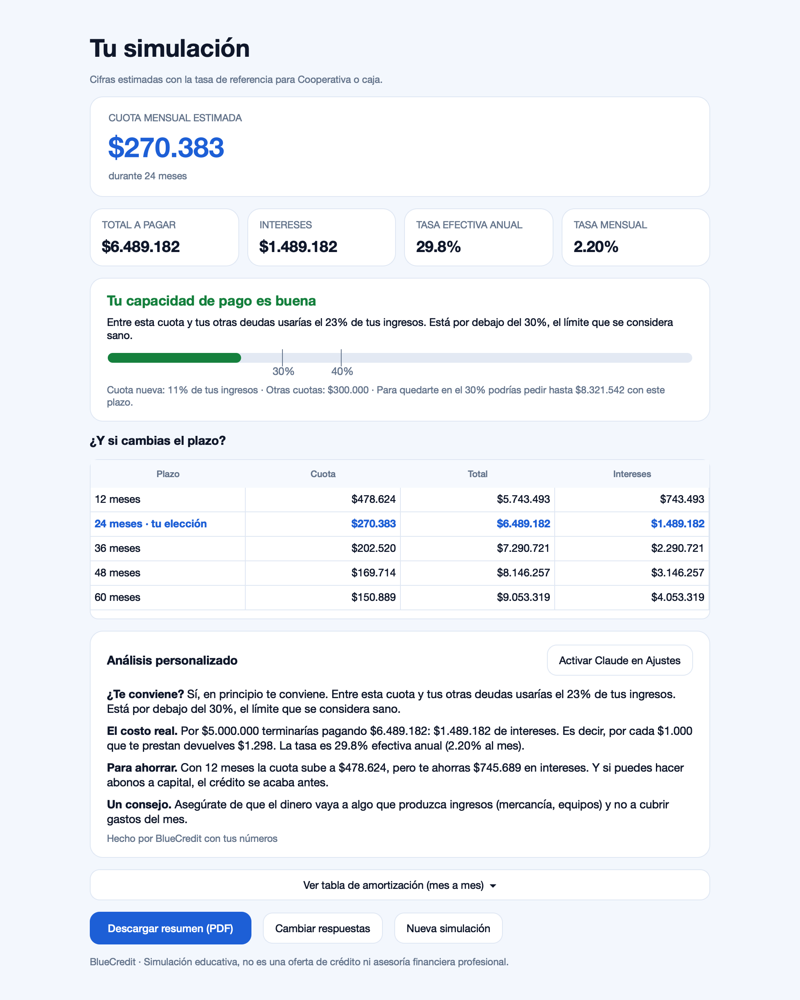
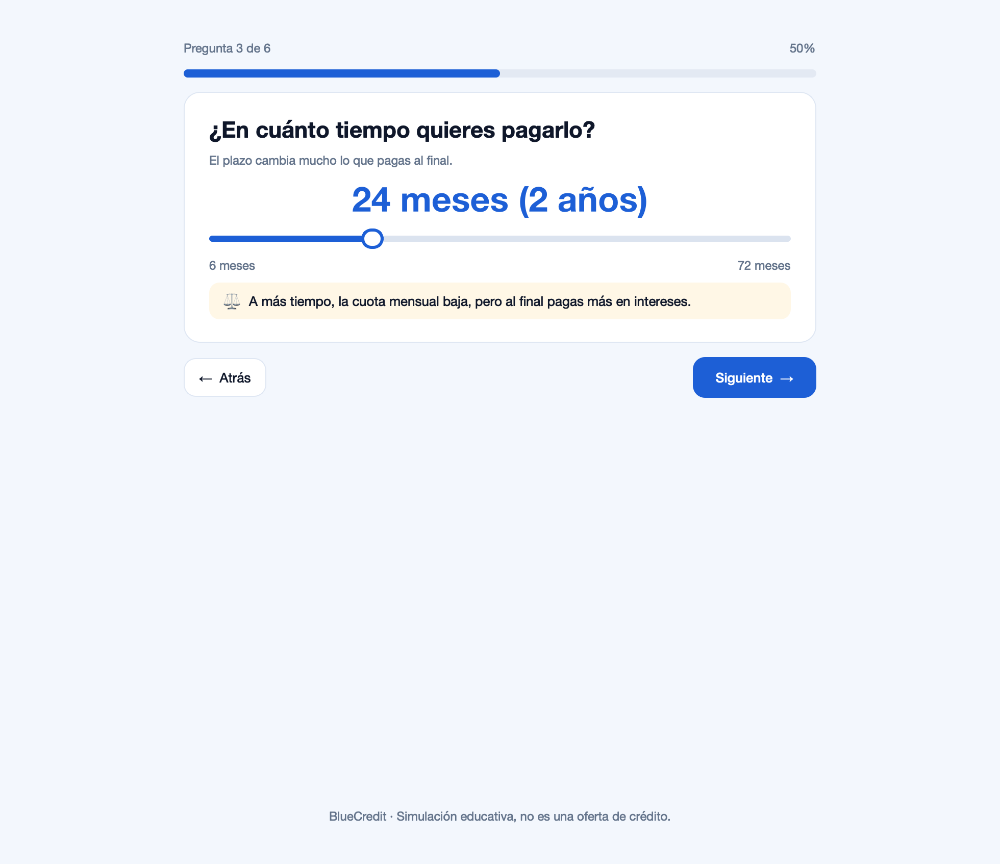

<p align="center">
  
</p>

<h1 align="center">BlueCredit</h1>

<p align="center">
  <b>¿Estás pensando en pedir un crédito?</b><br>
  Un simulador de escritorio que te dice, en lenguaje simple, cuánto pagarías de verdad y si te conviene.
</p>

<p align="center">
  
  
  
  
</p>

<p align="center"></p>

*English summary: BlueCredit is a Spanish-language loan simulator for Colombia. It answers six questions, then gives the real monthly payment, total cost, effective annual rate, a debt-to-income check that includes existing debts, a usury-rate warning, a month-by-month schedule and a PDF summary.*

## Qué hace

Respondes **6 preguntas** (monto, para qué, plazo, ingresos, cuánto pagas hoy en otras cuotas y dónde pedirías el crédito). BlueCredit te muestra:

- **La cuota mensual** con el sistema francés, el que usan los créditos de consumo en Colombia.
- **El costo real:** total a pagar, intereses, y cuánto devuelves por cada $1.000 prestados.
- **La tasa bien expresada:** efectiva anual (E.A.) y su equivalente mensual. Si ya te ofrecieron una tasa, puedes escribirla.
- **Tu capacidad de pago con todas tus deudas:** la cuota nueva más las que ya pagas, frente al 30% y al 40% de tus ingresos. También te dice el monto máximo que podrías pedir quedándote en el 30%.
- **Alerta de usura:** si configuras la tasa de usura vigente, te avisa cuando una tasa la supera.
- **Comparación de plazos** (12 a 60 meses) y la **tabla de amortización** mes a mes.
- **Un análisis en español** con consejos según para qué es el dinero. Opcionalmente lo escribe Claude, con una clave que se guarda en el llavero del sistema.
- **Un resumen en PDF** para llevar al banco o compartir.

No pide datos personales y todo se calcula en tu computador.

<p align="center"></p>

## Instalar

**Descarga:** la versión para Mac y Windows está en [Releases](../../releases).

> En macOS la app aún no está notarizada. La primera vez, haz clic derecho sobre ella y elige **Abrir**.

**Desde el código:**

```bash
git clone https://github.com/ianjacobo2009-hub/bluecredit.git
cd bluecredit
python3 -m venv .venv && source .venv/bin/activate
pip install -r requirements.txt
python -m bluecredit
```

En **Archivo → Ajustes** puedes cambiar las tasas de referencia por tipo de entidad, escribir la tasa de usura del mes (la publica la Superintendencia Financiera) y agregar una clave de Claude.

## Las cuentas

| | Fórmula |
|---|---|
| Tasa mensual | `i = (1 + E.A.)^(1/12) − 1`, no E.A. ÷ 12 |
| Cuota (sistema francés) | `C = P · i / (1 − (1 + i)^−n)` |
| Endeudamiento | `(otras cuotas + cuota nueva) ÷ ingresos`: hasta 30% es sano, 30–40% es ajustado, más de 40% es riesgoso |
| Monto máximo sano | el préstamo cuya cuota llena el espacio hasta el 30%, con la misma tasa y plazo |

Corre las pruebas con `pip install pytest && python -m pytest -q`. Revisan:

- la conversión entre E.A. y tasa mensual
- que la tabla de amortización termine en saldo cero
- que la capacidad de pago cuente las otras deudas
- el monto máximo sano
- la alerta de usura

## Del prototipo al software

BlueCredit nació como una página web. Esta versión de escritorio es una reescritura completa que corrige dos problemas del prototipo:

1. **Mostraba la tasa equivocada.** El prototipo cobraba bien la tasa mensual (por ejemplo 1,8%), pero la mostraba como "anual" multiplicándola por 12 (21,6%). La tasa efectiva anual real es **23,9%**. Para las fintech la diferencia era mayor: 42% mostrado frente a **51,1%** real.
2. **No usaba tus otras deudas.** Preguntaba cuánto pagabas en otras cuotas, pero el veredicto solo miraba la cuota nueva. Ahora el análisis se hace con todo tu endeudamiento.

## Estructura

```
bluecredit/
  finance.py   tasas, cuota, amortización, capacidad de pago, usura
  advice.py    análisis en español (local o con Claude)
  app.py       la interfaz de escritorio (PySide6) y el PDF
tests/         pruebas de las cuentas
```

## Aviso

Simulación educativa. No es una oferta de crédito ni asesoría financiera profesional. Las tasas de referencia son aproximadas: pide siempre la tasa E.A. y el costo total por escrito.

---

Hecho por **Ian** · [Blue Peak AI & Finance Solutions](https://github.com/ianjacobo2009-hub)
